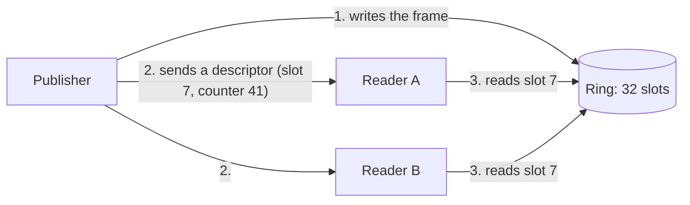

# Rings

A ring is the place where a publisher stores frames for the readers on its host. This page explains why Durchblick
uses rings, how a ring works, and what a reader must do with a frame from a ring.

## The problem: one copy per reader

A 1080p colour frame has 6 MB. A publisher that sends the frame over a network connection copies these 6 MB once
for every subscriber. With 16 subscribers on the same host, the publisher spends 26 ms of CPU time per frame on
Zenoh over TCP. At 30 frames per second this is most of one CPU core, and the frames only move from one process to
the next on the same machine.

## The idea: write once, tell everyone where

The publisher writes each frame once into memory that all processes on the host can open. It then sends a small
message, the *descriptor*, which states where the frame is. A reader receives the descriptor and reads the frame in
place.



The publisher now needs about 1 ms of CPU time per 1080p frame for 16 readers. An additional reader adds no work
for the publisher.

| 1080p to 16 readers on one host | Publisher CPU per frame |
| --- | --- |
| Zenoh over TCP | 26 ms |
| Ring, readers copy the frame | 1.2 ms |
| Ring, readers use the frame in place | 0.9 ms |

Measured on 2026-10-26 on an AMD EPYC 9335.

## How a ring works

A ring is a fixed set of slots which the publisher fills in turn. You can picture a carousel with 32 trays. The
publisher puts each new frame on the next tray and sends the tray number to the readers. A reader looks at the frame
and leaves it on the tray. After 32 frames the publisher reuses the first slot.

The publisher never waits for a reader. A slow reader can therefore find that the publisher has already replaced the
frame it wanted. Each slot has a counter for this case, a *sequence lock*. The publisher increments the counter when
it starts to write and again when it has finished. A reader compares the counter with the value in the descriptor
before and after it reads. If the counter changed, the reader discards the frame and counts it as `stale`. A reader
therefore never returns a frame that mixes two images.

An image ring has 32 slots by default, so a reader has 31 frame periods to read a frame. At 30 Hz this is about one
second. A point cloud ring has 4 slots, so a reader has 3 frame periods.

A ring grows when the publisher writes a larger frame. A camera that restarts with a higher resolution keeps its
ring and its readers.

## Two kinds of ring

| Ring | Memory | A reader gets | Transport name |
| --- | --- | --- | --- |
| Host ring | POSIX shared memory, `/dev/shm/xblick-…` | a NumPy array | `shm` |
| CUDA ring | GPU memory that several processes map | a device array on the GPU | `cuda` |

Both rings are Durchblick's own. They do not use [Zenoh's shared
memory](https://docs.rs/zenoh/1.10.1/zenoh/shm/index.html).

Both kinds use the same slots, counters and descriptors. [Frames on the GPU](gpu-frames.md) explains what is
different for the CUDA ring.

A ring exists on one host. The topic of its descriptors therefore ends with the id of that host, and a reader
subscribes to the topic of its own host. A descriptor never travels to another machine.

## Copy or view

A reader can take a frame from a host ring in two ways.

**Copy (the default).** The reader copies the frame out of the slot and checks the counter. The frame is then yours
and stays valid.

```python
images = db.ImageSubscriber(session, "demo/camera/color", transport="shm")
frame = images.latest(timeout=1.0)
```

**View (`copy=False`).** The reader returns an array that points into the slot. You save the copy, and you must
check afterwards that the publisher did not replace the frame while you worked on it.

```python
views = db.ImageSubscriber(session, "demo/camera/color", transport="shm", copy=False)
frame = views.latest(timeout=1.0)
result = process(frame.image)
if not frame.is_valid():      # the publisher replaced the slot meanwhile
    result = None             # discard the result
```

Use views for short work on large frames. Use copies when your work on one frame can take longer than 31 frame
periods.

## What follows for your node

- Read a frame soon after its descriptor arrives. A subscriber does this for you when you call `latest()`.
- A node that pairs two streams reads the partner frame when it takes the primary frame. The
  [pairing guide](../guides/pairing-streams.md) shows the classes for this.
- A stale frame is normal under load. A reader reports the count in its statistics, and the node goes on.
- A ring drops frames even when the publisher is a [blocking publisher](latest-value.md#blocking-publishers).

## Rings left behind

A publisher removes its ring when it ends. A publisher that is killed with SIGKILL, or that crashes, cannot remove
it. The ring then stays in `/dev/shm` until you remove it or the PC restarts. A host ring of a 1080p colour stream
with 32 slots takes about 200 MB of memory.

The name of a ring does not tell whether its publisher still runs, because you may start a publisher several times
on purpose. Each ring therefore records its creator in its header: the process id and the start time of that
process. The start time tells the creator apart from a later process that got the same process id. The header also
records when the creator wrote its last frame.

The creator also holds a lock (`flock`) on the ring file for as long as it lives. The kernel releases the lock when
the process ends, however it ends. A ring whose lock is free has no living creator. Readers never ask for the lock.
The lock is advisory, so it keeps no reader from opening or mapping the ring. The creator takes it once, when it
creates the ring, and does nothing with it per frame.

`xblick clean` lists the rings on this PC and judges each one by its lock and its creator record.

| State | Meaning | `xblick clean --remove` |
| --- | --- | --- |
| creator living | the recorded creator runs and holds the lock | keeps the ring |
| creator gone | the lock is free, and the recorded creator has ended | removes the ring if no process maps it |
| unknown | the ring has no creator record. Programs of 0.5.11 and older write such rings. | keeps the ring |
| lock held | a process other than the recorded creator holds the lock | keeps the ring |
| another user's | the ring belongs to another user | keeps the ring |

To clean up after a killed publisher:

1. Run `xblick clean`. It lists every ring and marks those it would remove.
2. Run `xblick clean --remove`.

A ring of the state "unknown" may belong to a living program of an older version. If no process maps it,
`xblick clean --remove --force <ring>` removes it. The command looks for mapping processes among the processes of
your user. Other users cannot open your rings, because a ring file allows access to its owner only.

A process that forks without exec inherits the descriptor of each ring it created, and with it the lock. The ring
then counts as alive while that child process lives. Python's `multiprocessing` with the start method `fork` does
this.

**CUDA rings.** The control block of a CUDA ring is a file of 4 kB in `/dev/shm`. A killed publisher leaves it
behind as well. `xblick clean` lists it with the kind `cuda` and removes it in the same way. The GPU memory of a CUDA
ring is not a file. The handshake socket is an abstract Unix socket, which ends with its process. The CUDA driver
frees the GPU memory when the creator has ended and every reader has released its import of the memory. A subscriber
keeps its reader of a ring until a frame from a new ring arrives or until the subscriber closes. A subscriber that
still reads a killed CUDA publisher therefore holds that publisher's GPU memory until then. `xblick clean` names
such a subscriber as a process that maps the ring. End or restart that subscriber to free the GPU memory.

## Related pages

- [Transports](transports.md): how a subscriber chooses between a ring and the network.
- [Frames on the GPU](gpu-frames.md): the CUDA ring.
- `cpp/include/xblick/ring.hpp`: the layout of a host ring, the creator record, the creator lock and the sequence lock.
- [Command line](../reference/cli.md#xblick-clean-rings-): `xblick clean`.
