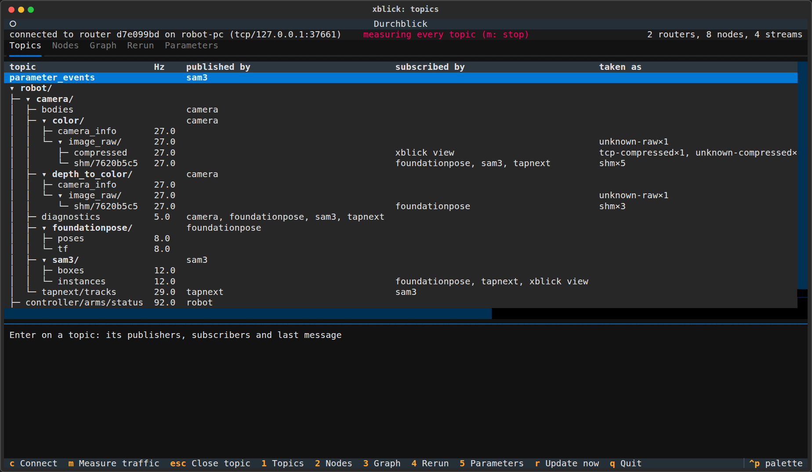
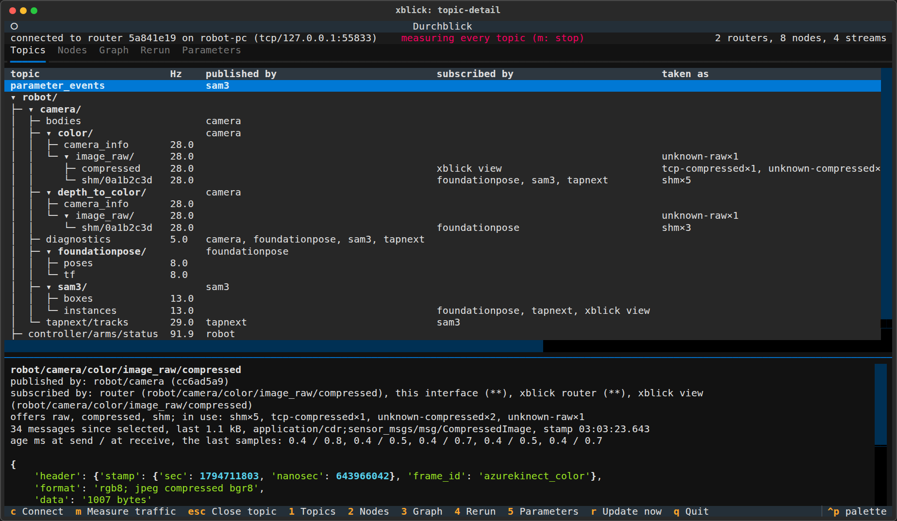
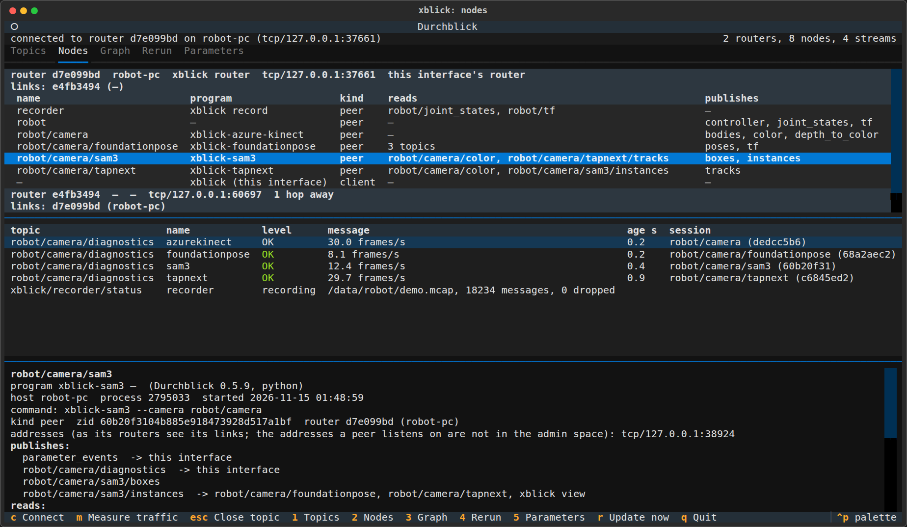
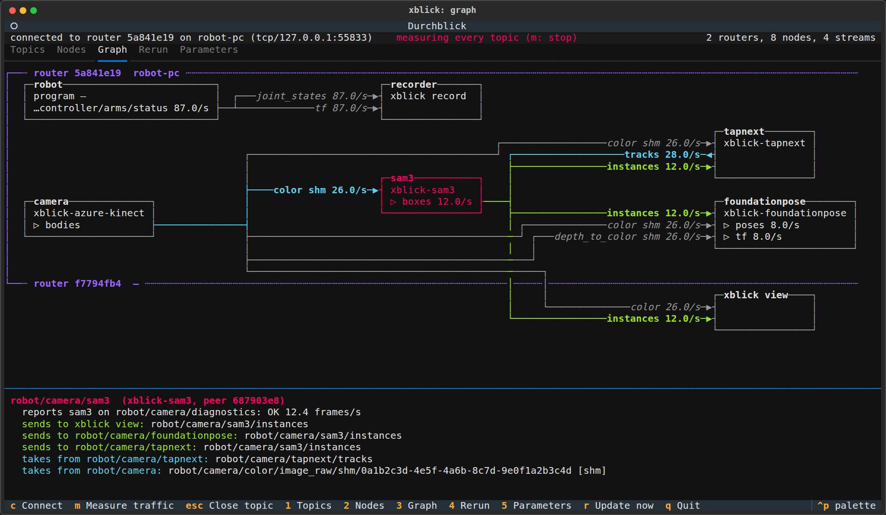
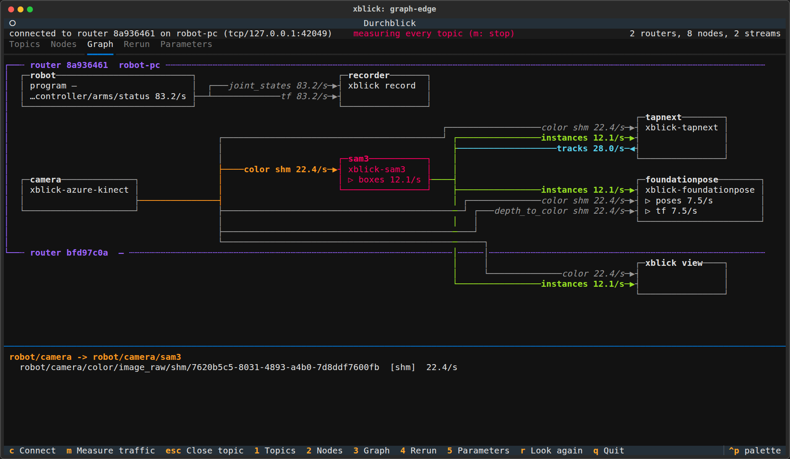
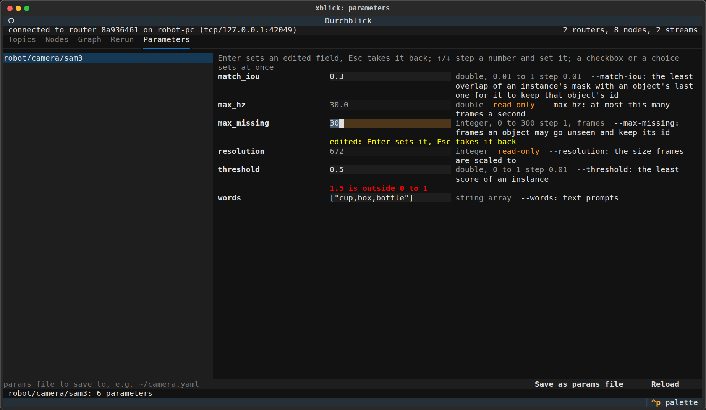
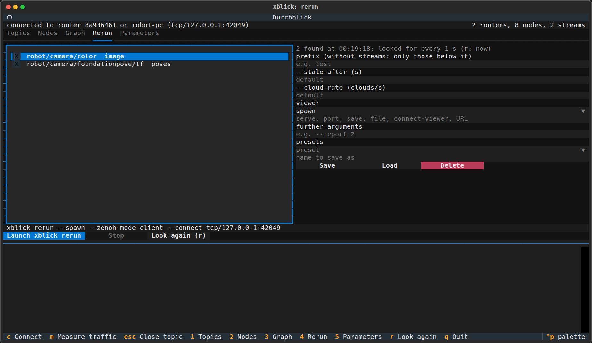
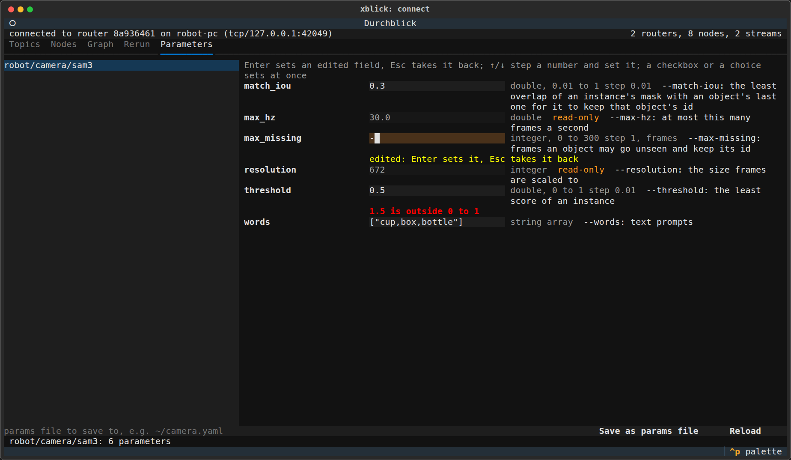

# Terminal interface

`xblick` without a command opens a terminal interface. It shows every topic, node and parameter that the
routers and the topics report, and it starts the viewer. It needs no knowledge of any particular node.

```bash
xblick
```

The interface needs a terminal of at least 80 x 24 characters. Without a terminal, for example in a pipe or a
service, the command refuses with a message.

The screenshots on this page show a network that `tools/tui_screenshots.py` makes up. Two routers are linked:
`robot-pc` runs an Azure Kinect with body tracking, SAM 3, FoundationPose, TAPNext, a robot state bridge of an older version and a
recorder, and a viewer is attached to the second router. The script regenerates them after a change to the
interface.

The line under the title names the router the interface is connected to, by its id, its host and the address. On
its right it counts the routers, the nodes and the streams.

## Tabs

| Tab | Content |
| --- | --- |
| Topics | every key that a session publishes, as a tree. `m` measures all of them: rate, size, type, last stamp and age. Enter on a topic subscribes to it alone and shows its publishers, its subscribers, the info record of the stream, and its last message decoded. |
| Nodes | every node by router: cameras, processing nodes, tools and the interface itself, with name, program, kind and what each reads and publishes. The routers and their links. The reports on every `<camera>/diagnostics`. The status of the record and play nodes. |
| Graph | the nodes as boxes in one band per router, and the data between them as arrows. A selected node shows what it sends and takes, and the mouse over an edge shows its keys. |
| Rerun | everything that `xblick rerun` can show, as a tree by camera and node, and the options of `xblick rerun`. The tab builds the command line from the marked entries and checks it with the command's own parser. "Launch" runs it as a child process, and "Stop" sends it SIGTERM. |
| Parameters | the nodes that offer parameters, and a form built from the descriptors of the chosen node: numbers with range, step and unit, a switch for a boolean, a selection for choices. Read-only parameters are marked. A refused change shows its reason under the field. The node's events keep the values current. "Save as params file" writes them. See [parameters](../reference/parameters.md). |

### Topics



The first column is the key tree. A prefix with a single child and no key of its own joins that child, for example
`depth_to_color/image_raw/shm/0c9a1f6e`. The last part is the host of the ring, shortened to 8 characters. Enter on a prefix folds it and shows the number of keys below it. Enter again
unfolds it.

The columns "published by" and "subscribed by" name the nodes. A name stands on the highest row below which
every key has the same nodes, and the keys below that row leave the cell empty. In the screenshot, `azurekinect`
stands once on `color/`, and `diagnostics` lists every session that reports on it. The names are short: a session
is named without the name of the session whose name is a prefix of its own, so `test/camera/sam3` becomes
`sam3`. The Nodes tab and the detail panes show the whole names.

The column "Hz" stays empty until something subscribes: `m` for all topics, or Enter for one. A node's own rate
is in its diagnostics report, which the Nodes tab and the detail of the graph show. These rates cost nothing,
because the interface subscribes to the diagnostics in any case. A node reports one rate, so the interface does not
assign it to the node's keys.



### Nodes



Every row is a node: a camera, a processing node, a tool, or the interface itself. The rows stand in groups, one
per router. The head of a group has the colour of the table headers and three lines:

1. the router: its id, its host, its program, the address it listens on, and its distance from the interface's
   router in hops,
2. its links: every router it is linked to directly, by id and host,
3. the names of the columns.

The groups follow the distance from the interface's router, the nearest first. Routers form a mesh, so the links
line is a list. A last group "without a router" holds the nodes that are linked to the interface directly.

| Column | Content |
| --- | --- |
| name | the camera or node name that you type elsewhere, for example `test/camera/yolox`, else `–` |
| program | the program, for example `xblick-yolox` or `xblick view`. `@<host>` follows when it runs on another host than its router. `–` for a program that declares nothing. |
| kind | `peer` or `client` |
| reads | the streams and keys it subscribes to |
| publishes | its streams and keys, relative to its name where they are below it, for example `color` or `detections_2d` |

A cell that is too narrow shows the number of topics. The shared keys `<camera>/diagnostics` and
`parameter_events` stand only in the detail.

The detail below the reports belongs to the row under the cursor. For a node it shows the program with its version
and Durchblick's version, the host, the process id, the start time and the whole command line. It shows the Zenoh id,
the kind, the router and the addresses of the node's links as its routers see them. It lists every key the node
reads and publishes, the nodes that read each published key, and the keys it answers. A node's parameter services
count as "N parameter services". For a router row the detail shows its Zenoh version, the addresses it listens
on, and each link with its addresses.

The admin space does not contain the addresses that a peer listens on, so the detail shows only the addresses of
its links. A host comes from the program's own declaration. For a router that is not `xblick router`, for
example `zenohd`, the host is the first address it listens on that names a host, else `–`.

### Graph



A session that declares no program of ours but publishes camera topics in ROS 2, such as a ROS camera driver, has
the name of its ROS node and the mark `(ROS)` on its box, and its camera topics in it.

The graph draws one band per router. A line with the router's id and host heads each band, and the lines on the
left join the bands of linked routers. A node that takes data from another stands in a column to the right of it,
also across bands. Each line is one topic from its publisher to one reader, and it enters the reader's box on a row
of its own. The label before the arrow names the topic, relative to the publisher's name, and how the reader takes
it (`shm`, `cuda`, `tcp-compressed`), for example `color shm`. While `m` measures every topic, the label ends with
the topic's rate, for example `instances 12.4/s`. A topic with several readers has a line to each, and each line
carries the rate once. A label that is too long drops how the topic is taken, which the detail shows.

The rate is the number of messages per second of that key as this interface receives them. It is measured only
while `m` runs, because measuring subscribes to every topic. A node's own report on diagnostics gives one rate for
the whole node, so the detail below the graph shows it and the lines do not.

A box shows the node's name on its border and its program in the first line. A program without a name shows its
program on the border. Below stand the topics that nobody takes, marked `▷`, with their rates while `m` measures.

The arrow keys or a click select a node. Its outgoing edges turn green and its incoming edges cyan, and the pane
below lists the keys of each. The mouse over an edge shows the keys of that edge and how each is taken.

A large graph does not fit the terminal. Shift and an arrow key move the view, and so does a drag with the mouse in
a terminal that reports the mouse. `0` or Home returns to the start of the graph, its top left corner.



Two nodes that take each other's data form a cycle. The graph draws one edge of the cycle against the flow,
and its arrow `◀` points out of the box on its right side. In the screenshot, SAM 3 takes TAPNext's tracks, and
TAPNext takes SAM 3's instances. The graph leaves out the interface itself.

The drawing follows Sugiyama's layered layout in a small form. Netext (a Python library that draws graphs with
Rich) was considered, and the interface does not use it. It would add a dependency with a Rust part, and its
documentation describes neither edge routing nor interaction.

### Parameters



A node opens when it is highlighted in the list on the left. Each parameter takes one line: its name, its field, and
what its descriptor says. On a terminal narrower than 120 columns the descriptor's text stands under the field.

| Key | Action |
| --- | --- |
| Enter | set the edited field |
| Esc | take the edit back |
| ↑, ↓ | step a number by the step of its range, and set it at once. Without a step, an integer steps by 1 and a double by a hundredth of its range. |
| Space | toggle a checkbox, which sets it at once |

A field that is edited and not yet set has a yellow background. Under a field stands the node's reason for a
refused change, or "set" for two seconds after a change is taken. A field with the cursor keeps what is typed while
the node reports other values.

Every node offers its command-line options as parameters. The live ones change while the node runs, and the others
are read-only and apply at the next start. The node's README names its live parameters.

### Rerun



The left side lists what `xblick rerun` can show. Each entry is a topic of its own: a camera's streams, its
transforms, IMU and diagnostics, and below each node its results. A camera that exists only as ROS topics stands
below the namespace of its topics, marked `(ROS)`, without transforms ([ROS cameras](../integrations/ros2.md#show-and-record-a-ros-camera)). The note beside an entry says what the viewer
makes of it, for example "drawn over color". The header counts the entries and says when the list was updated. The
list updates itself every few seconds, and `r` or "Update list now" updates it at once. A new topic appears at the
next update, and an entry whose publisher ended disappears then.

Space, Enter or a click marks an entry. The command line then names it. The first marked entry of a camera also
marks the camera's transforms, `tf, tf_static`, which place its streams in 3D. You can unmark them. When the
publisher of a marked entry ends, the entry stays and says "gone since" with the time. An entry of a preset that
was never found says "not found". Nothing marked starts `xblick rerun` without a selection, so it shows everything
that it finds.

The right side holds the options of `xblick rerun`. They apply at its start, so the tab fixes them while it runs.
The marks stay changeable. A change of the marks applies at once to the running `xblick rerun`, through its
parameters. The viewer keeps its layout, and a new entry appears in its list of data. While it runs, the notes say
over which images it draws each result. See the [viewer guide](viewer.md#change-the-selection-while-it-runs).

## Keys

| Key | Action |
| --- | --- |
| `1` to `5` | select a tab |
| arrows, Enter | move in the table, tree or list of the tab, open a topic, show a node's or router's detail, fold a prefix of the topics |
| Space, Enter | in the Rerun tab: mark an entry, fold a camera or node |
| arrows, click, mouse | in the graph: select a node, show an edge |
| shift and arrows, a drag | in the graph: move the view |
| `0`, Home | in the graph: back to its start |
| `m` | measure all topics |
| `r` | update the lists now |
| `Esc` | close the topic |
| `c` | connect again |
| `q` | quit |

On a terminal narrower than 120 columns, the lists of the Rerun tab stand one above the other, and the tables
scroll sideways.

## Connect

The interface connects like every command: without options to the router of this PC. `c` opens a dialog to connect
again, to this PC's router, to endpoints, or through a Zenoh configuration file. The dialog opens with the cursor in
the address field, so an address and Enter are enough. An address without a protocol takes `tcp/`, and an address
without a port takes 7447: `robot-pc` connects to `tcp/robot-pc:7447` as a client. Typing into a field selects
that field's way of connecting. The commands' `--connect` and `--listen` take the same short forms.

When the interface starts on this PC's router and finds nothing there, it opens the dialog by itself. This happens
when no router answers or no other session is attached.



```bash
xblick --connect <host>              # tcp/<host>:7447, as a client: everything through that router
xblick --config FILE
```

With `--connect`, the interface is a client by default. Add `--listen` to make it a peer. The interface refuses a
peer with `--connect` and without `--listen`, also with `--zenoh-mode peer`, and states the reason. Its rule differs
from the commands' rule. A command accepts this combination and then listens on a free loopback port of this PC.
Peers on other PCs or behind an SSH tunnel cannot connect to that port, so such a peer would receive nothing from
them.

### Over SSH

Run these commands on your own computer, with Durchblick installed there:

```bash
ssh -N -L 7447:127.0.0.1:7447 server
xblick --connect tcp/127.0.0.1:7447
```

The interface must be a client here. A peer would see the sessions and could not reach them, because the router
gives it loopback addresses of the server. In that case the interface says "not reachable from here". To view
streams through the tunnel, give `xblick rerun` the same options: `--zenoh-mode client --connect
tcp/127.0.0.1:7447`. It then receives compressed images.

## How the interface knows what it shows

**Nodes, routers and the graph** come from the [admin space](https://zenoh.io/docs/manual/abstractions/#admin-space)
of the routers, which `zenohd` serves read-only by default. Each router's record lists the routers it is linked to,
which gives the mesh and the hops. When the interface is connected only to peers, it says that no router answered,
and it shows only streams and traffic.

**Names and programs.** Every program on Durchblick's library declares itself: its program, version, names, host,
command line, process id and start time ([protocol](../concepts/protocol.md#every-program-declares-itself)). The
interface asks for these records at every look at the network, and a program that starts or ends makes it look at
once. A program that declares nothing shows `–` as its program, and its name is the common prefix of its keys, for
example `robot/stereo/left` and `robot/stereo/right` give `robot/stereo`. The command line of every program is
visible to everything that reaches the network.

**Another system on the same PC.** Sessions find each other through their router, because multicast scouting is
off. A second system with its own router on the same PC is therefore invisible until you connect the interface to
that router (`c`).

**Diagnostics.** The reports of several nodes on one camera share `<camera>/diagnostics`. Each sample names its
session in the attachment field `zid`, so each report appears under its session. A sample without this field
appears as "unknown".

**How a stream is taken.** The column "taken as" shows the transport of each consumer.

| Value | Meaning |
| --- | --- |
| `shm`, `cuda` | the consumer reads the ring on the publisher's host |
| `<protocol>-raw`, `<protocol>-compressed` | the consumer receives the frames over Zenoh. The protocol is that of its link to its router, such as `tcp`, `udp` or `unixsock-stream`. |
| `unknown` | the routers know no link of this session. The interface states the reason. |

For a network transport, the interface also shows the address that the router sees and the path of the data. The
data of a client pass through its router. Between peers the admin space shows no links, so the interface makes no
claim about the path of a peer. Beside the value, it lists the transports that the stream offers.

**Measuring costs work.** `m` subscribes to every topic, as `xblick list --traffic` does. All publishers then
produce every representation, including raw images, while the measurement runs.

## Presets

The Rerun tab stores named presets in `~/.config/xblick/rerun_presets.json`, or below `$XDG_CONFIG_HOME`. A
preset contains its marked entries, the cameras whose transforms are unmarked, its options and its Zenoh connection. Loading a preset connects to its connection.
